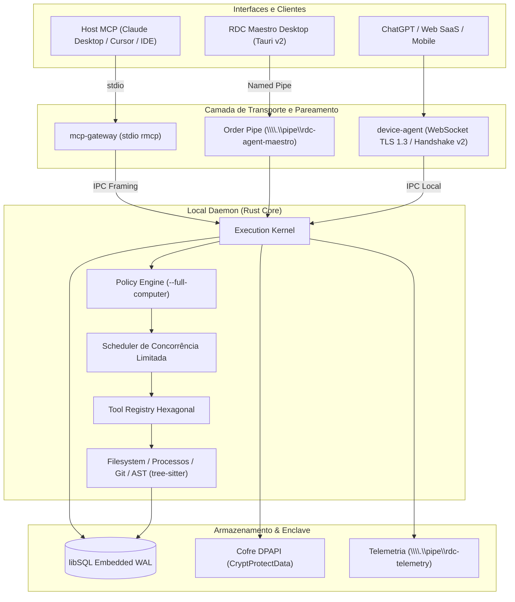

# Remote Desktop Controller (RDC) — v0.5.0

[](https://github.com/Remote-Desktop-Controller/remotecontroller/releases)
[](https://www.rust-lang.org)
[](https://tauri.app)
[](LICENSE)
[]()

> **Runtime local-first de alta segurança e orquestrador multi-provedor (ChatGPT, Claude, Gemini, DeepSeek, Qwen) para automação e controle assistido de computador.**

O **Remote Desktop Controller (RDC)** é uma plataforma concebida para permitir que agentes de inteligência artificial interajam com o sistema operacional local de forma determinística, segura e auditável. Construído em **Rust**, com persistência transacional em **libSQL (WAL)** e interface desktop nativa em **Tauri v2 / React 19**, o RDC elimina a necessidade de sandboxes pesadas, dependências de Node.js/Python no runtime principal ou exposições inseguras de portas TCP no firewall.

---

## 🏛️ Arquitetura do Sistema



---

## ✨ Principais Capacidades (v0.5.0)

1. **Local-First & Zero Cloud Lock-in:** O núcleo de execução (`local-daemon`) e o adaptador MCP (`mcp-gateway`) operam de forma 100% autônoma e offline. Não há telemetria forçada ou dependência de servidores remotos para uso local.
2. **RDC Maestro Desktop (Orquestrador Multi-LLM):** Interface nativa em Tauri v2 que opera instâncias web do ChatGPT, Claude, Gemini, DeepSeek e Qwen. Permite debate colaborativo no **Blackboard Feed** e gera planos consensuais aprovados pelo operador humano (*Human-in-the-Loop*).
3. **Motor Furtivo de Execução Biomecânica (`stealth`):**
   - Movimentação de mouse em **curvas de Bézier cúbicas** com aceleração e desaceleração cinemática fisiológica.
   - Cadência de digitação estocástica com distribuição Gaussiana.
   - Sentinela de desafios contra bloqueios (Cloudflare Turnstile, hCaptcha e reCAPTCHA).
4. **Isolamento por Enclave e Cofre DPAPI:**
   - O estado do sistema reside fora do workspace (`%LOCALAPPDATA%\LocalRuntime`).
   - Segredos e chaves são cifrados no repouso via **Windows DPAPI** (`CryptProtectData`).
5. **Controle Total com Consentimento (`--full-computer`):**
   - Concede acesso a escritas, processos fora do workspace e rede de forma auditável.
   - Rejeição absoluta de shells cegos (`sh -c` ou `cmd.exe /c`); execução exclusiva por binários explícitos e vetores de argumentos tipados.
6. **Edições Atômicas & Diff de Myers:** Todas as alterações em arquivos exigem validação prévia de integridade SHA-256 e gravação em arquivos temporários renomeados atomicamente.
7. **Pareamento Remoto Seguro (Handshake v2):** Conexão via túnel seguro de saída (*outbound-only* WebSocket TLS) em conformidade com a especificação **RFC 9207** para integração com o ChatGPT Actions.

---

## 🚀 Como Executar

### 1. Requisitos de Compilação
- **Rust:** 1.88+ (Edition 2024)
- **Node.js & npm:** 20+ (apenas para a interface web do RDC Maestro)
- **C/C++ Build Tools:** MinGW-w64 ou MSVC (para compilação do libSQL, libgit2 e tree-sitter).

### 2. Executar o Daemon Local e Gateway MCP

Compilar todo o workspace:
```powershell
cargo build --workspace
```

Iniciar o daemon de execução apontando para o seu diretório de trabalho:
```powershell
.\target\debug\local-daemon.exe --workspace "C:\meu-projeto" --allow-write
```

Em outro processo (ou configurado no seu host MCP como Cursor ou Claude Desktop):
```powershell
.\target\debug\mcp-gateway.exe --endpoint "\\.\pipe\local-runtime-meu-projeto" --token-file "C:\Users\<user>\AppData\Local\LocalRuntime\meu-projeto\ipc.secret"
```

### 3. Iniciar o RDC Maestro Desktop (Interface Multi-Provedor)

Para iniciar o orquestrador desktop integrado com WebView2:
```powershell
.\iniciar-maestro.bat
```
ou via terminal:
```powershell
cd apps\rdc-maestro
npm install
npm run tauri dev
```

---

## 🧰 Catálogo de Ferramentas (MCP Tools)

| Grupo | Ferramentas | Descrição |
|---|---|---|
| **Filesystem** | `read`, `read_range`, `list`, `search`, `stat`, `write`, `patch`, `batch_edit` | Leitura, escrita e busca indexada com conferência de hash SHA-256 e diff de Myers. |
| **Processos** | `spawn`, `status`, `stdout`, `stderr`, `kill` | Execução controlada de processos filhos vinculados a Job Objects (Windows) ou guardiões (Unix). |
| **Git** | `status`, `diff`, `show` | Inspeção nativa de repositório via libgit2 embutida (sem invocação de binário git externo). |
| **Workspace** | `info` | Metadados do ambiente, raízes canonicalizadas e capabilities ativas. |
| **Contexto** | `recent`, `causal`, `compile` | Grafo de eventos causais persistido em libSQL para compilação de contexto de alta densidade. |
| **Operações** | `status`, `cancel` | Consulta de estado transacional e cancelamento cooperativo de operações em andamento. |
| **Checkpoints** | `create`, `rollback` | Pontos de restauração de estado do filesystem e banco com reversão atômica. |
| **AST Code** | `code.inspect`, `code.symbols` | Análise léxica e sintática estruturada para Rust e Python via tree-sitter compilado. |

---

## 📚 Documentação e Especificações (RFCs)

Decisões de engenharia e especificações de protocolos estão registradas em nossa suíte de RFCs:

- 📖 **[Índice Geral de RFCs](docs/rfcs/README.md)**
- [RFC-0001: Runtime Local de Execução para Agentes (v0.2.0)](docs/rfcs/0001-runtime-local.md)
- [RFC-0002: Protocolo de Pareamento Remoto e Handshake Mútuo v2 (v0.3.0)](docs/rfcs/0002-remote-pairing-protocol.md)
- [RFC-0003: Controle Total do Computador, Isolamento por Enclave e Telemetria (v0.4.0)](docs/rfcs/0003-full-computer-access-enclave.md)
- [RFC-0004: RDC Maestro — Orquestrador Multi-Provedor Desktop e Motor Furtivo (v0.5.0)](docs/rfcs/0004-rdc-maestro-stealth-orchestrator.md)
- [RFC-0005: Portal Comercial SaaS, Faturamento Integrado e Distribuição v0.5.0](docs/rfcs/0005-commercial-portal-distribution.md)
- [Guia de Arquitetura Detalhado](docs/architecture.md)
- [Modelo de Segurança e Fronteira de Confiança](docs/security.md)

---

## 🔒 Segurança e Privacidade

- **Sem Elevação Silenciosa:** O RDC não executa autoelevação para Administrador. Opera com as permissões do usuário corrente.
- **DACL de IPC:** Named Pipes utilizam descritores de segurança do Windows restritos ao usuário e SYSTEM (`PIPE_REJECT_REMOTE_CLIENTS`).
- **Validação de Paths:** `cap-std` confina todas as resoluções de caminho ao diretório de trabalho, protegendo contra *path traversal* (`../`) e links simbólicos maliciosos.
- **Desinstalador Cirúrgico:** O script `uninstall.ps1` valida caminhos e encerra cirurgicamente apenas processos do produto, protegendo diretórios vizinhos de exclusão acidental.

---

## 📄 Licença

Este projeto é distribuído sob a licença **MIT**. Consulte o arquivo [LICENSE](LICENSE) para mais detalhes.  
Dependências incorporadas com licenças próprias estão documentadas em seus respectivos diretórios (`vendor/libsql`, `vendor/portable-pty`).
