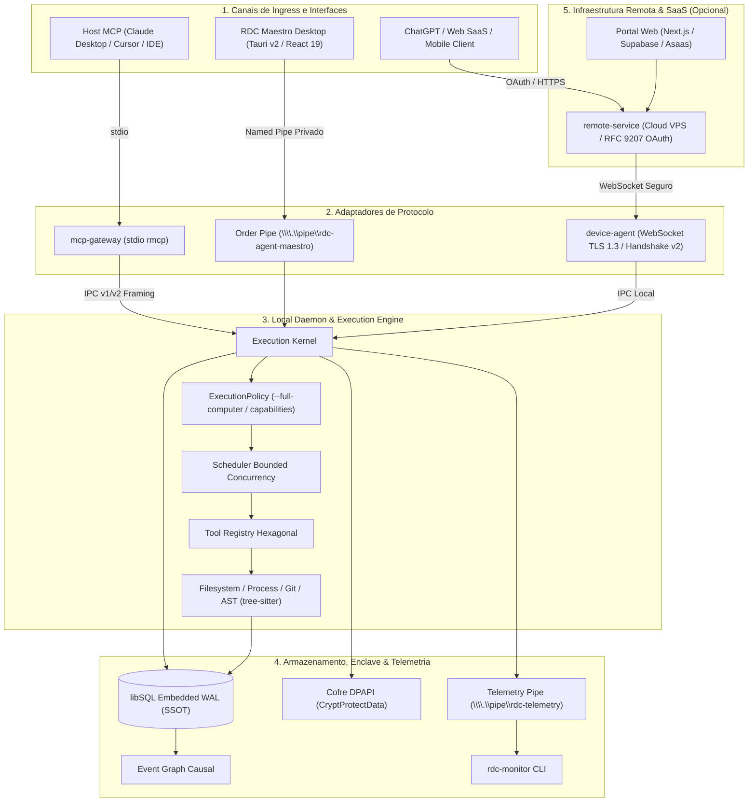

# Arquitetura do Remote Desktop Controller (RDC) — v0.5.0

O **Remote Desktop Controller (RDC)** é uma plataforma integrada e *local-first* projetada para conectar agentes de inteligência artificial ao computador local do operador humano com limites estritos de segurança, persistência transacional e orquestração multi-provedor.

---

## 1. Visão Geral do Sistema (v0.5.0)

A arquitetura do RDC opera em cinco camadas desacopladas que garantem isolamento de privilégios, independência de nuvem para execução local e compatibilidade multi-plataforma:

---

## 2. Divisão de Crates e Arquitetura Hexagonal

A base de código em Rust adota estritamente os princípios de arquitetura hexagonal (*ports and adapters*):

| Crate / Aplicação | Responsabilidade | Dependências Externas |
|---|---|---|
| `crates/domain` | Entidades fundamentais, identidades com UUID v4, invariantes de domínio, modelos de capability e transições de estado. | **Zero** dependências de Tokio, Serde, JSON, banco de dados ou APIs de sistema operacional. |
| `crates/ports` | Contratos abstratos (`traits`) para Repositórios, Ferramentas (`ToolPort`), Filesystem, Processos, Git, Relógio e Contexto. | Apenas contratos puros. |
| `crates/application` | Coordenação de casos de uso: admissão e agendamento de operações, autorização de políticas, cancelamento gracioso e compilação causal de contexto. | `crates/domain`, `crates/ports`, `async-trait`. |
| `crates/protocol` | Envelopes serializáveis de requisição/resposta (`RequestEnvelope`, `ResponseEnvelope`), tipos de erro de fio (`WireError`), DTOs versionados. | `serde`, `serde_json`, `rmp-serde`, `bytes`. |
| `crates/transport` | Implementação de transporte IPC de baixo nível: Named Pipes no Windows (com DACL restrito ao usuário e SYSTEM) e Unix Domain Sockets no Linux/macOS. Framing com prefixo de tamanho de 32 bits e limite de 8 MiB. | `tokio`, APIs nativas do SO. |
| `crates/infrastructure` | Implementação concreta dos adaptadores: banco de dados libSQL local em modo WAL com integridade referencial, cache Moka, isolamento DPAPI (`windows::Win32_Security_Cryptography`), analisador de sintaxe tree-sitter, diff de Myers (`similar`), e barramento de observabilidade. | `libsql`, `moka`, `similar`, `tree-sitter`, `windows`. |
| `apps/local-daemon` | Ponto de entrada do serviço de execução local (`local-daemon.exe`). Inicializa o kernel, carrega configurações, gerencia ciclo de vida, expõe o canal do Maestro e serve o IPC principal. | Todos os crates do workspace. |
| `apps/mcp-gateway` | Servidor MCP nativo (`mcp-gateway.exe`). Conecta hosts MCP via stdio (`rmcp`) e traduz as chamadas para envelopes IPC autenticados direcionados ao daemon local. | `rmcp`, `runtime-transport`, `runtime-protocol`. |
| `apps/rdc-maestro` | Aplicativo desktop nativo Tauri v2 + React 19 / Tailwind v4. Orquestrador multi-provedor (ChatGPT, Claude, Gemini, DeepSeek, Qwen), feed compartilhado de blackboard, motor furtivo de biomecânica em curvas Bézier e sentinela anti-bot. | `tauri`, `webview2-com`. |

---

## 3. Isolamento, Enclave e Segurança

1. **Estado Fora do Workspace:** O diretório de banco de dados, chaves e arquivos temporários é sempre alocado no enclave privado do usuário (`%LOCALAPPDATA%\LocalRuntime\<workspace-hash>`), garantindo que ferramentas que limpam ou modificam o repositório jamais destruam ou exponham o estado do runtime.
2. **Cofre DPAPI Criptográfico:** Credenciais de autenticação remota e tokens de sessão são cifrados no Windows com as chaves nativas do usuário (`CryptProtectData`), impedindo que outros processos ou usuários na mesma máquina leiam os segredos.
3. **Escopo `--full-computer` com Consentimento:** Por padrão, o daemon concede apenas leitura e inspeção Git. Acesso a escritas, inicialização de processos filhos, rede e diretórios fora do workspace exige o parâmetro explícito `--full-computer` concedido conscientemente pelo operador.
4. **Rejeição de Shells Cegos:** Execuções de programas não usam strings de shell não estruturadas (`sh -c` ou `cmd /c`), exigindo programa executável explícito e lista controlada de argumentos.
5. **Edições Atômicas com Diff de Myers:** Qualquer alteração em arquivos verifica o hash prévio do conteúdo (prevenindo sobrescritas acidentais) e aplica as edições atomicamente através de arquivos temporários renomeados na conclusão.

---

## 4. Orquestração Multi-Provedor com RDC Maestro

O RDC Maestro desktop inova ao permitir que o usuário opere múltiplos provedores de inteligência artificial de forma coordenada:
- **Sessões WebView2 Persistentes:** Cada provedor mantém seus cookies e autenticação salvos no diretório local de dados `EBWebView`.
- **Motor Biomecânico de Curvas de Bézier:** Os comandos de mouse utilizam trajetórias com curvas cúbicas e perfis de aceleração fisiológica, prevenindo disparos de mecanismos de detecção de bots.
- **Sentinela de Desafios:** Detecta desafios do Cloudflare Turnstile, hCaptcha e reCAPTCHA, pausando automações e solicitando intervenção manual do operador quando necessário.
- **Canal de Ordens com Aprovação Humana:** O operador humano visualiza o plano sintetizado no Blackboard e aprova explicitamente a execução antes que os comandos sejam despachados para o `Local Daemon`.
