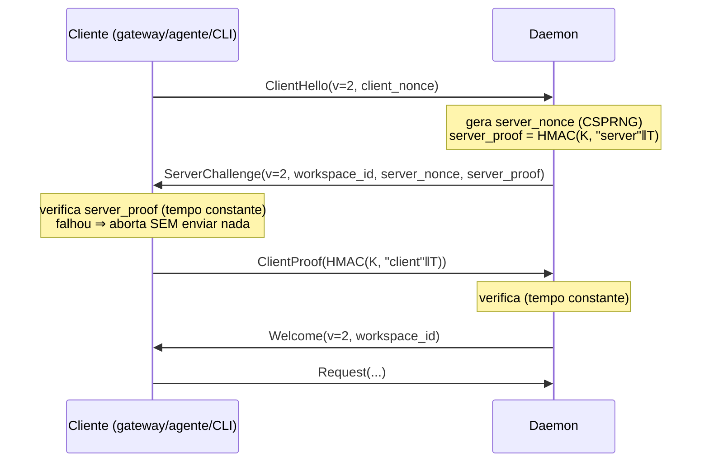

# Sub-projeto 1 — Autenticação mútua do IPC local (v2)

**Status:** spec para revisão · **Data:** 2026-10-04 · **Branch:** `codex/remote-product`
**Contexto:** parte do produto descrito em [`../spec.md`](../spec.md). Este documento especifica só o sub-projeto 1; os demais (relay, pareamento, PTY…) têm specs próprias e **reutilizam** o protocolo definido aqui.

---

## 1. Problema

O handshake IPC v1 (`crates/transport/src/lib.rs`, `authenticate` / `Client::once`) é **unilateral**:

1. O cliente envia `Hello { protocol_version, secret }` com o **segredo em claro** para quem estiver ouvindo no endpoint.
2. O servidor compara em tempo constante e responde `Welcome`. O cliente **nunca verifica quem é o servidor**.

Consequências:

| Ameaça | Como acontece hoje |
|---|---|
| **Captura do segredo (S1)** | No Windows o nome do pipe é `\\.\pipe\local-runtime-<sha256(state_dir)[..16]>` (determinístico). Outro usuário local pode criar o pipe antes do daemon; o gateway conecta e entrega o segredo. No Unix o fallback `/tmp/rdc-<hash>/daemon.sock` é igualmente previsível. |
| **Alocação pré-autenticação** | `receive` aceita frames de até 8 MiB (`MAX_FRAME`) de um peer ainda não autenticado (`vec![0; len]`). |
| **Falha silenciosa de versão** | Um cliente v1 contra servidor novo (ou o inverso) falha em decode de MessagePack, sem erro tipado. |

Quando o relay remoto existir, o mesmo canal passa a carregar comandos originados no ChatGPT. O protocolo precisa estar correto **antes** disso.

## 2. Objetivos e não-objetivos

**Objetivos**
- G1. O segredo **nunca trafega** no IPC. Cada lado prova conhecê-lo por HMAC-SHA256.
- G2. O **cliente autentica o servidor antes** de revelar qualquer prova própria.
- G3. Provas ligadas à conexão (nonces frescos de ambos os lados), à versão e ao `workspace_id`; sem replay nem reflexão.
- G4. Frames pré-autenticação limitados a **1 KiB** e handshake inteiro com **um** deadline de 5 s.
- G5. Geração e consumo do segredo endurecidos (S4/S6): CSPRNG, criação atômica privada, leitura sem seguir links e validando dono/modo.
- G6. `VERSION` 1 → 2 com falha **tipada e legível** entre peers de versões diferentes.
- G7. Correções S3 (ordem de inicialização do daemon) e S5 (`--config` explícito inexistente) dentro do mesmo marco.

**Não-objetivos** (decisões conscientes)
- Confidencialidade do canal: o IPC é local e protegido por ACL/0700/0600; não se adiciona TLS/Noise. Quem lê o tráfego local já é o mesmo usuário.
- Rotação automática do segredo / comando `rotate-secret`: fora de escopo; documentar o procedimento manual (§5.5).
- Autenticação agente↔relay (chave de dispositivo): sub-projeto 3.
- Isolar um processo malicioso que já rode como o mesmo usuário e possa ler `ipc.secret` (modelo de ameaça de `docs/security.md` permanece).
- Bump do semver dos crates / empacotamento: fica para a release; este marco só exige nota de release (§8).

## 3. Handshake v2

### 3.1 Mensagens

Quatro frames de handshake, mesmo enquadramento de hoje (u32 BE + MessagePack, `to_vec_named`):

| # | Direção | Frame | Campos |
|---|---|---|---|
| 1 | C → S | `ClientHello` | `protocol_version: u16`, `client_nonce: [u8; 32]` |
| 2 | S → C | `ServerChallenge` | `protocol_version: u16`, `workspace_id: Uuid`, `server_nonce: [u8; 32]`, `server_proof: [u8; 32]` |
| 3 | C → S | `ClientProof` | `client_proof: [u8; 32]` |
| 4 | S → C | `Welcome` | `protocol_version: u16`, `workspace_id: Uuid` (**inalterado**) |

Em qualquer ponto o servidor pode responder `Error(ErrorEnvelope)` e fechar. Depois do `Welcome` o fluxo é idêntico ao v1: um `Request`, zero ou mais `Event`, um `Response`.



### 3.2 Provas

`K` = os 32 bytes de `ipc.secret`, usados **diretamente** como chave HMAC (já são uniformes de um CSPRNG; HKDF não agrega nada aqui — YAGNI).

Transcrição `T` (codificação inequívoca, campos de tamanho fixo):

```
T = label ‖ 0x00 ‖ u16_be(protocol_version) ‖ workspace_id(16 bytes) ‖ client_nonce(32) ‖ server_nonce(32)

server_proof = HMAC-SHA256(K, T com label = "rdc-ipc/v2/server")
client_proof = HMAC-SHA256(K, T com label = "rdc-ipc/v2/client")
```

- Labels distintos ⇒ a prova do servidor não pode ser refletida como prova do cliente.
- `server_nonce` e `client_nonce` entram nas duas provas ⇒ uma prova gravada não vale em outra conexão.
- `workspace_id` entra na prova ⇒ o cliente não é enganado sobre qual workspace está falando; o `Welcome` precisa repetir o mesmo `workspace_id` do `ServerChallenge` (senão `ServerAuthentication`).
- Verificação **sempre** via `Mac::verify_slice` (tempo constante). Proibido comparar com `==`.
- Nonces: 32 bytes de `getrandom` (CSPRNG do SO), novos a **cada tentativa**, inclusive nos retries do `Client`.

**Vetores de teste (known-answer)**, gerados por implementação independente (Node `crypto`), para fixar o formato bit a bit:

```
K              = 00 01 02 ... 1f                      (32 bytes, 0x00..0x1f)
protocol_ver   = 2
workspace_id   = 00112233-4455-6677-8899-aabbccddeeff
client_nonce   = a0 repetido 32×
server_nonce   = b0 repetido 32×
server_proof   = a8f18825d326822122455ddb11f5ef1f05e33b7090d48c2a3494950e920359ec
client_proof   = 41a8b713636b18758d0517f9b0452968a7c7576be5ab5a036634f5845ad8b3f3
```

### 3.3 Comportamento do servidor (`authenticate`)

Assinatura **preservada**: `authenticate(stream, secret, workspace_id) -> Result<()>`. `server::serve`, `connection` e todos os chamadores ficam intactos.

1. Um único `tokio::time::timeout(5 s)` envolve o handshake **inteiro** (hoje só cobre o primeiro `receive`; um peer lento no frame 3 ocuparia o slot indefinidamente).
2. Frames do handshake lidos com `receive_limited(stream, HANDSHAKE_MAX_FRAME = 1024)`; acima disso ⇒ `FrameLimit`, conexão fechada, **nenhuma alocação** do corpo.
3. Primeiro frame:
   - `ClientHello` com `protocol_version == VERSION` → segue.
   - `ClientHello` com versão diferente → `Error(VersionMismatch, "unsupported IPC version")`.
   - **`Hello` legado v1** (§4.2) → `Error(VersionMismatch, "IPC v1 client is not supported; update mcp-gateway/agent to match the daemon")`. O campo `secret` **não é lido nem comparado, nem logado**.
   - Qualquer outro frame → `Error(Unauthorized, "handshake required")`.
4. Envia `ServerChallenge`. Aguarda `ClientProof` (mesmo deadline global).
5. Prova inválida, frame inesperado ou segredo do servidor com `len != 32` → **uma única** resposta `Error(Unauthorized, "IPC authentication failed")` (mensagem idêntica para todos os casos de autenticação: sem oráculo sobre qual etapa falhou) e fecha.
6. Sucesso → `Welcome`.

Um cliente não autenticado consegue obter do servidor apenas `HMAC(K, "server"‖T)` para um `client_nonce` de sua escolha. HMAC-SHA256 é PRF e o label separa domínios; isso não revela `K` nem permite forjar `client_proof`. O custo é limitado pelo semáforo `ipc_connections` e pelo deadline de 5 s.

### 3.4 Comportamento do cliente (`Client::once`)

Assinatura **preservada**: `Client::new(endpoint: String, secret: Vec<u8>)` e `Client::request(...)`. `device-agent`, gateway, `lifecycle` e testes não mudam de chamada.

1. `connect`; gera `client_nonce`; envia `ClientHello`.
2. Recebe com `receive_limited(1024)`:
   - `ServerChallenge` → segue.
   - `Error(e)` → `IpcError::Peer(e)` (ex.: `VersionMismatch` legível).
   - outro → `IpcError::Unexpected`.
3. Confere `protocol_version == VERSION`; **verifica `server_proof`**. Falha ⇒ `IpcError::ServerAuthentication` (variante nova), **sem enviar mais nenhum byte** e sem fechar com erro de I/O. O segredo e qualquer prova do cliente nunca chegam a um servidor falso.
4. Envia `ClientProof`; recebe `Welcome`/`Error`; confere que `workspace_id` do `Welcome` == o do `ServerChallenge`.
5. Retry: `ServerAuthentication`, `Peer(_)`, `FrameLimit` e `Encoding` **não** são repetidos (só `IpcError::Io`, como hoje). Cada tentativa repete o handshake do zero, com nonce novo.

`IpcError::ServerAuthentication` tem mensagem fixa `"daemon identity could not be verified"`; é erro permanente de configuração/ataque, não transitório.

## 4. Mudança de protocolo e `VERSION`

### 4.1 `crates/protocol`

- `pub const VERSION: u16 = 2;` — constante **única**, usada tanto no handshake quanto em `Metadata.protocol_version` (já checada em `server.rs`, `kernel.rs` e `device-agent/src/lib.rs`). Os três pontos seguem o valor automaticamente; nenhum literal `1` hardcoded fora dos testes listados em §7.
- `pub const HANDSHAKE_MAX_FRAME: usize = 1024;`
- `Frame` ganha `ClientHello`, `ServerChallenge`, `ClientProof`. `Welcome`, `Request`, `Response`, `Event`, `Error` ficam **idênticos**.
- Sem `derive(Debug)` em `Frame` (hoje já é assim) — mantém provas/nonces fora de logs acidentais. Nenhum tipo novo deriva `Debug` com os bytes; usar newtype `Proof([u8; 32])` com `Debug` redigido (`Proof(<redacted>)`).
- Persistência: **nenhum dado persistido guarda `protocol_version`** (verificado em `migrations/*.sql` e `storage*.rs`). Sem migração.

### 4.2 Compatibilidade v1 ↔ v2 (falha explícita, nunca silenciosa)

`Frame::Hello` legado é **mantido apenas como variante de rejeição**:

```rust
#[serde(rename = "Hello")]
LegacyHello { protocol_version: u16, secret: Vec<u8> },
```

| Cenário | Resultado |
|---|---|
| Cliente v1 → daemon v2 | Daemon decodifica `Hello`, responde `Error(VersionMismatch, "IPC v1 client is not supported; …")` sem tocar no segredo. Cliente v1 já sabe decodificar `Frame::Error` e mostra a mensagem (`IpcError::Peer`). |
| Cliente v2 → daemon v1 | Daemon v1 falha em decodificar `ClientHello` (variante desconhecida) e fecha a conexão. O cliente v2 vê EOF/`Io`; **sem** revelar segredo (nunca o enviou). Mensagem de `doctor` orienta a atualizar (§8). Limitação aceita: daemon v1 não é modificável retroativamente. |
| Cliente v2 → daemon v2 | Handshake normal. |

> `LegacyHello` carrega um segredo em claro, mas apenas na direção cliente-v1→servidor, que já existia; o servidor v2 o descarta imediatamente (`drop` sem logar). Remover a variante em uma versão futura (v3) quando v1 deixar de existir em campo.

## 5. Injeção da chave secreta

“Injeção” = como `ipc.secret` nasce no daemon e chega a cada cliente **sem aparecer em argv, env, logs ou rede**.

### 5.1 Modelo (mantido do v0.2)

```
state_dir/ (0700 / DACL protegida, FORA do workspace)
├── daemon.lock      lock exclusivo ⇒ um daemon por state_dir
├── ipc.secret       32 bytes binários, 0600 / DACL privada
└── runtime.db, daemon.log, …
```

- Daemon: **gera** (se ausente) e **lê** no start.
- Clientes (`mcp-gateway --token-file`, `device-agent`, `local-daemon connect/stop/doctor`): **recebem o caminho** do arquivo (nunca o conteúdo) e leem o segredo ao iniciar.
- O segredo não é passado por argumento, variável de ambiente nem stdin; só o caminho.

### 5.2 Geração (corrige S4)

Substitui `uuid::new_v4() × 2` (12 bits fixos por UUID; escolha semanticamente frágil) por **32 bytes de `getrandom::fill`**.

Criação **atômica e privada desde o primeiro byte**:

1. Garante `state_dir` privado e verificado (§6.1).
2. Remove `ipc.secret.tmp` obsoleto (crash anterior).
3. Cria `ipc.secret.tmp` com `create_new(true)`:
   - Unix: `OpenOptionsExt::mode(0o600)` **no `open`** (sem janela entre criar e `chmod`).
   - Windows: cria vazio, aplica `private_file` (DACL protegida, convenção do repositório “privado antes de gravar bytes”), só então grava.
4. `write_all` + `sync_all`.
5. `rename` para `ipc.secret` (atômico no mesmo diretório); Unix: `fsync` do diretório pai.

Efeito: nunca existe `ipc.secret` com conteúdo parcial. Se o processo morrer em qualquer ponto, no próximo start ou existe um arquivo completo ou nenhum. O lock exclusivo de `daemon.lock` (adquirido antes) elimina a corrida entre dois daemons.

### 5.3 Leitura (corrige S6) — `read_secret(path)`

Mesma assinatura (`io::Result<Vec<u8>>`). Passa a:

1. Abrir **o handle uma vez** e validar **no handle** (sem TOCTOU entre `symlink_metadata` e `read`):
   - Unix: `O_NOFOLLOW`; `fstat`: arquivo regular, `uid == geteuid()`, `mode & 0o077 == 0`.
   - Windows: abrir sem seguir reparse point (`FILE_FLAG_OPEN_REPARSE_POINT`) e rejeitar se o handle for reparse point/diretório; o ACL é garantido pela pasta de estado privada (`private_directory`).
2. Exigir exatamente 32 bytes.
3. Retornar em `Zeroizing<Vec<u8>>` internamente; a API pública devolve `Vec<u8>` (compatibilidade). `Client` guarda o segredo em `Zeroizing<Vec<u8>>` (sem `Debug`/`Clone` do conteúdo em claro: `Client` mantém `Clone` via `Arc<Zeroizing<Vec<u8>>>`). Zerização é defesa em profundidade, não promessa de forense de memória.

### 5.4 Erros acionáveis

- Arquivo com modo largo / dono errado → `PermissionDenied` com a mensagem `"ipc.secret must be owned by the current user with mode 0600"`.
- Tamanho ≠ 32 → `"ipc.secret is corrupted (expected 32 bytes); stop all gateways and delete it to regenerate"`. O daemon **não** regenera automaticamente um arquivo existente inválido (não troca silenciosamente o segredo sob gateways ativos).

### 5.5 Rotação (procedimento manual, sem comando novo)

Parar `connect`/daemon e todos os gateways → apagar `ipc.secret` → iniciar daemon (gera novo) → reiniciar gateways. Um cliente com segredo antigo obtém `ServerAuthentication` (identidade não verificável) em vez de `Unauthorized` — sinal correto: “segredo diferente”. Documentar em `docs/recovery.md`.

## 6. Correções S3 e S5 (daemon)

### 6.1 S3 — nada é criado antes de o state dir ser validado

Hoje `tracing_subscriber` abre `state_dir/daemon.log` **antes** de `private_directory` e do `ensure!(!state.starts_with(root))`. Um `--state-dir` dentro do workspace gravaria log lá antes da recusa.

Nova ordem em `apps/local-daemon/src/main.rs` (após `lifecycle::resolve`):

1. Validar containment de `state_dir` vs `workspace` com o **mesmo helper** (lexical + ancestrais resolvidos) já usado para `--config` (`lifecycle.rs`, regressão `aaf579a`), **antes** de qualquer `create_dir_all`/arquivo.
2. `private_directory(state_dir)`.
3. `canonicalize` + `ensure!(!state.starts_with(root))` (cinto e suspensório).
4. Só então inicializar o `tracing_subscriber` (→ `daemon.log`).
5. Lock → segredo (§5.2) → listener → kernel.

Falhas das etapas 1–3 vão para **stderr** do processo (o subscriber ainda não existe) e saem com código ≠ 0.

### 6.2 S5 — `--config` explícito inexistente é erro

Hoje `lifecycle::resolve` preenche `args.config` com `state_dir/runtime.json` quando omitido, tornando `Some` sempre; `main.rs` trata ausência como “usar default”, inclusive quando o operador **digitou** um caminho errado (política do operador descartada em silêncio).

- `Args` ganha `config_explicit: bool` (derivado em `resolve` **antes** de aplicar o default).
- `config_explicit && !path.exists()` → erro: `"--config <path> not found"` (código ≠ 0).
- Não explícito e ausente → `RuntimeConfig::default()` (comportamento atual).
- A checagem de “config fora do workspace” continua valendo para ambos.

## 7. Plano de testes (TDD: RED primeiro, evidência em `docs/product/ipc-mutual-auth/evidence/`)

Ciclo por teste: escrever → rodar → **ver falhar pelo motivo certo** (log RED) → implementar o mínimo → GREEN (log). Cargo: `C:\Users\Notebook\.cargo\bin\cargo.exe` (não está no PATH), `-j 2`, `--locked` (exceto a primeira build que adiciona `hmac`).

### 7.1 Unitários — `crates/protocol`

| ID | Teste | Verifica |
|---|---|---|
| P1 | `version_is_2_and_metadata_uses_it` | `VERSION == 2`; `Metadata::new` usa `VERSION`. |
| P2 | `handshake_frames_round_trip_msgpack` | `ClientHello/ServerChallenge/ClientProof` serializam e voltam; tamanho do pior caso (bytes `0xFF`) `< HANDSHAKE_MAX_FRAME`. |
| P3 | `legacy_hello_decodes_from_v1_bytes` | Bytes MessagePack de um `Hello{protocol_version:1,secret}` capturados do v1 (fixture embutida) decodificam como `LegacyHello`. |
| P4 | `proof_debug_is_redacted` | `format!("{:?}", Proof(..))` não contém os bytes. |

### 7.2 Unitários — `crates/transport` (`tests/authentication.rs` reescrito, `tests/framing.rs` ajustado, módulo `handshake`)

Usam `tokio::io::duplex`, sem processo.

| ID | Teste | Verifica |
|---|---|---|
| T1 | `known_answer_server_and_client_proofs` | KAT de §3.2: as funções de prova reproduzem exatamente os dois hex (comparação byte a byte). |
| T2 | `mutual_handshake_succeeds_and_secret_never_on_wire` | `Client::once`-equivalente × `authenticate` sobre duplex com **tap** que grava todos os bytes; handshake OK; os 32 bytes do segredo **não aparecem** no tap. |
| T3 | `client_rejects_server_with_wrong_secret` | Servidor falso (segredo diferente) responde `ServerChallenge` válido sintaticamente; o cliente retorna `ServerAuthentication` e o tap mostra **zero bytes enviados após o `ClientHello`** (nenhum `ClientProof`). |
| T4 | `client_rejects_mismatched_workspace_in_welcome` | `Welcome.workspace_id` ≠ `ServerChallenge.workspace_id` ⇒ `ServerAuthentication`. |
| T5 | `server_rejects_wrong_client_proof` | `ClientProof` errado ⇒ `Error(Unauthorized, "IPC authentication failed")`; `authenticate` retorna `Err`. |
| T6 | `server_error_message_is_identical_for_all_auth_failures` | Prova errada, frame errado no passo 3 e EOF produzem a mesma mensagem (sem oráculo). |
| T7 | `reflected_server_proof_is_rejected` | Cliente malicioso devolve o `server_proof` como `client_proof` ⇒ rejeitado (label distinto). |
| T8 | `replayed_transcript_is_rejected` | Grava uma conexão válida (`ClientHello`, `ClientProof`) e a reproduz numa conexão nova ⇒ rejeitada (`server_nonce` novo). |
| T9 | `nonces_are_fresh_per_connection_and_per_retry` | Dois handshakes consecutivos produzem `client_nonce` e `server_nonce` distintos. |
| T10 | `wrong_protocol_version_is_typed` | `ClientHello{v=99}` ⇒ `Error(VersionMismatch)`. |
| T11 | `legacy_hello_gets_version_mismatch_without_secret_comparison` | Envia `LegacyHello` com o **segredo correto**: ainda recebe `VersionMismatch` (prova de que não foi comparado) e a conexão fecha. |
| T12 | `oversized_handshake_frame_rejected_before_allocation` | Prefixo de tamanho `1025` no primeiro frame ⇒ `FrameLimit` sem ler corpo (duplex de 64 bytes). |
| T13 | `handshake_has_single_global_deadline` | Usa `authenticate_with_deadline(stream, secret, ws, Duration::from_millis(300))` (`authenticate` a chama com 5 s; sem `tokio::time::pause`, pois o feature `test-util` não está habilitado). O cliente envia `ClientHello`, lê o `ServerChallenge` e nunca envia o `ClientProof`: retorna `Deadline` em ≈300 ms **totais** (≤ 450 ms medidos), não 300 ms por etapa. |
| T14 | `short_server_secret_rejected` | `authenticate` com segredo de 31 bytes ⇒ falha fechada (nunca aceita). |
| T15 | `client_does_not_retry_authentication_failures` | `ServerAuthentication`/`Peer` fazem 1 tentativa; `Io` mantém até 4. |
| T16 | `framing_round_trip_uses_new_frames` | `tests/framing.rs`: substitui `Frame::Hello` por `ClientHello`; `MAX_FRAME+1` continua rejeitado. |

### 7.3 Segredo — `crates/transport` e `apps/local-daemon`

| ID | Teste | Verifica |
|---|---|---|
| K1 | `read_secret_rejects_symlink_at_open` | Link para arquivo válido ⇒ erro (Unix `O_NOFOLLOW`; Windows reparse). |
| K2 | `read_secret_rejects_wrong_length` | 31/33 bytes ⇒ mensagem acionável de §5.4. |
| K3 | `read_secret_rejects_group_or_world_readable` (`#[cfg(unix)]`) | Modo `0644` ⇒ `PermissionDenied`. |
| K4 | `read_secret_rejects_foreign_owner` (`#[cfg(unix)]`, `#[ignore]` fora do CI Linux com `sudo`/fixture) | Dono ≠ euid ⇒ erro. |
| K5 | `secret_creation_is_atomic_and_private` | Gerador: arquivo final tem 32 bytes, modo 0600 no Unix; `ipc.secret.tmp` não sobra; teste de crash simulado (tmp pré-existente) é limpo no próximo start. |
| K6 | `generated_secrets_are_distinct_and_not_uuid_shaped` | 1.000 segredos únicos; nenhum tem os nibbles de versão/variante UUID nas posições 6 e 8. |
| K7 | `invalid_existing_secret_is_not_regenerated` | `ipc.secret` com 5 bytes ⇒ daemon recusa iniciar; arquivo intacto. |

### 7.4 Integração — servidor real (`crates/infrastructure/tests/ipc.rs`)

`Listener` real + `serve` + `Kernel` real (padrão do teste existente).

| ID | Teste | Verifica |
|---|---|---|
| I1 | `local_ipc_round_trip_progress_version_and_reconnect` (existente) | Continua verde: round trip, progresso, reconexão, `VersionMismatch` de Metadata (`protocol_version = 99`). |
| I2 | `rogue_listener_never_receives_secret_or_proof` | Um listener falso no endpoint (segredo diferente) aceita o `Client` real: `request` falha com `ServerAuthentication`; bytes brutos capturados pelo rogue **não contêm** o segredo do cliente nem um `ClientProof` válido. |
| I3 | `wrong_secret_client_is_unauthorized_and_slot_released` | Cliente com segredo errado ⇒ `Unauthorized`; em seguida um cliente correto conecta (o semáforo liberou o slot). |
| I4 | `slow_loris_handshake_frees_connection_slot` | Conexão que envia `ClientHello` e para: em 5 s o slot é liberado (`ipc_connections=1`, segunda conexão legítima passa). |

### 7.5 Integração — binários reais (`apps/local-daemon/tests/fullstack.rs`, `tests/lifecycle.rs`, novo `tests/ipc_auth.rs`)

Usam `RUNTIME_TEST_BIN_DIR` (binários **release** do CI) como os testes atuais.

| ID | Teste | Verifica |
|---|---|---|
| B1 | `fullstack_*` (existentes) | Daemon real + `mcp-gateway` real: `initialize`, `tools/list`, execução, crash/reconexão — **todos continuam verdes** com v2. |
| B2 | `gateway_binary_refuses_rogue_listener` | Teste cria `ipc.secret` válido e um `Listener` falso no endpoint; roda o **`mcp-gateway.exe` real** com `--token-file`: processo sai com erro contendo `daemon identity could not be verified`; os bytes capturados pelo rogue não contêm o segredo. |
| B3 | `v1_style_hello_against_real_daemon_gets_typed_error` | Cliente cru envia `LegacyHello` ao daemon real: recebe `Error(VersionMismatch)` com a mensagem de atualização; **`daemon.log` não contém o segredo**. |
| B4 | `daemon_generates_private_secret_once` | Daemon real cria `ipc.secret`: 32 bytes; Unix 0600; reiniciar o daemon **não** altera o conteúdo; nenhum `ipc.secret.tmp` restante. |
| B5 | `state_dir_inside_workspace_creates_nothing` (S3) | Daemon real com `--state-dir <workspace>/state`: sai ≠ 0; o workspace continua **idêntico** (nenhum `state/`, `daemon.log`, `daemon.lock`). |
| B6 | `explicit_missing_config_fails_but_default_missing_starts` (S5) | `--config <inexistente>` ⇒ ≠ 0 com `--config … not found`; sem `--config` ⇒ inicia com defaults. |
| B7 | `device_agent_uses_mutual_auth` | O teste existente `apps/device-agent/tests/remote_flow.rs` (relay + agente + daemon reais sobre loopback HTTP) continua verde: o agente usa o mesmo `Client`. |
| B8 | `doctor_reports_version_mismatch_actionably` | `doctor`/`connect` contra um servidor falso v1 (fixture que só entende `Hello`): mensagem orienta atualizar todos os binários juntos. |

### 7.6 Critérios de aceitação (todos obrigatórios)

1. Todos os testes acima verdes; cada teste de comportamento novo tem log RED anterior comprovando falha pelo motivo esperado (S1: T3, I2, B2; S3: B5; S5: B6; S4/S6: K1–K3, K5, K6).
2. `cargo fmt --check`, `cargo clippy --workspace --all-targets --all-features --locked -- -D warnings`, `cargo test --workspace --locked` limpos no Windows local; CI tri-OS verde (K3/K4/B4 modo Unix só rodam lá).
3. `grep` de CI/teste: nenhum `==` comparando provas; nenhum `Debug` de `Proof`/segredo; nenhuma ocorrência do segredo em `daemon.log`.
4. Nenhuma mudança de assinatura pública usada por `device-agent`, `mcp-gateway` e `lifecycle` (`Client::new`, `Client::request`, `read_secret`, `authenticate`, `Listener::bind`).
5. `docs/ipc-protocol.md`, `docs/security.md`, `docs/recovery.md` atualizados (v2, modelo de ameaça, rotação manual).

## 8. Arquivos afetados

| Arquivo | Mudança |
|---|---|
| `crates/protocol/src/lib.rs` | `VERSION=2`, `HANDSHAKE_MAX_FRAME`, novos `Frame`, `LegacyHello`, `Proof` |
| `crates/transport/src/lib.rs` | `receive_limited`, novo `authenticate`/`Client::once`, `IpcError::ServerAuthentication`, `read_secret` endurecido |
| `crates/transport/src/handshake.rs` (novo) | funções puras de transcrição/prova/verificação (testáveis com KAT; ~60 linhas) |
| `crates/transport/Cargo.toml` | `+ hmac = "0.12"`, `+ sha2 = "0.10"`, `+ getrandom = "0.4"`, `+ zeroize = "1"` |
| `apps/local-daemon/src/main.rs` | ordem de inicialização (S3), `config_explicit` (S5), geração/atômica do segredo (§5.2) |
| `apps/local-daemon/src/lifecycle.rs` | `config_explicit` em `resolve`; mensagem de `doctor` |
| `crates/*/tests`, `apps/*/tests` | §7 |
| `docs/ipc-protocol.md`, `docs/security.md`, `docs/recovery.md` | §7.6-5 |

**Não tocar:** relay (`remote-service`), PTY, storage, políticas. Dependências: `hmac` **não está** no `Cargo.lock`; `sha2 0.10.9`, `getrandom 0.4.3` e `zeroize 1.9.0` já estão (a primeira build após adicionar `hmac` atualiza o lock; as demais usam `--locked`). `fs2` e outros itens do relatório de análise ficam **fora** deste marco.

**Nota de release:** o IPC v2 quebra a interoperabilidade com v1 por desenho. Daemon, `mcp-gateway` e `device-agent` precisam ser atualizados **juntos**; o pacote nativo já entrega os três a partir do mesmo manifesto, e o instalador recusa atualização com gateway em uso (Windows).

## 9. Riscos e decisões a confirmar

| # | Risco / decisão | Proposta |
|---|---|---|
| R1 | Manter `LegacyHello` carrega um campo `secret` em claro no tipo. | Aceito só para rejeição tipada de peers v1; remover em v3. A alternativa (remover e deixar v1 falhar em decode) piora o diagnóstico sem ganho de segurança. |
| R2 | Servidor responde `server_proof` a qualquer peer antes de autenticá-lo. | Inevitável para autenticar o servidor primeiro; HMAC é PRF; custo limitado por semáforo/deadline. |
| R3 | `read_secret` no Windows não valida dono no handle (confia na DACL do state dir). | Aceito; alinhado a `docs/security.md`. Revisitar se o state dir puder residir fora de perfil de usuário. |
| R4 | Daemon recusa (não regenera) `ipc.secret` inválido. | Preferido a trocar o segredo sob gateways ativos; mensagem acionável (§5.4). |
| R5 | Bump de `VERSION` impacta `device-agent`/relay em campo. | Mesma entrega de binários; não há agente em campo ainda (produto não publicado). |

---

*Spec self-review: sem TBD; labels, tamanhos e ordem de campos fixados e verificados contra os vetores KAT; assinaturas públicas preservadas; escopo restrito a IPC local + S3/S4/S5/S6.*
