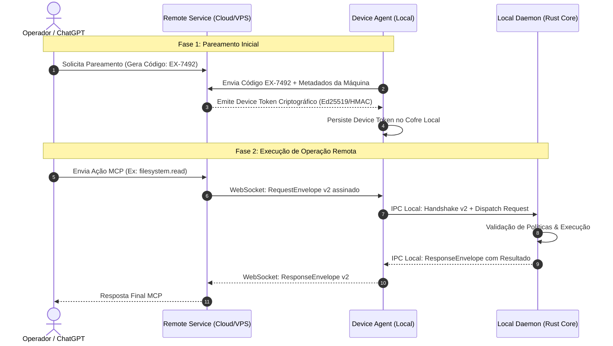

# RFC-0002 — Protocolo de Pareamento Remoto e Handshake Mútuo v2

**Status:** Aprovado & Implementado  
**Versão Alvo:** v0.3.0  
**Data:** 2026-10-05  
**Autor:** Remote Desktop Controller Core Team  
**Repositório:** https://github.com/Remote-Desktop-Controller/remotecontroller  

---

## 1. Sumário Executivo

O RFC-0001 definiu o runtime local puro (Local Daemon + MCP Gateway) restrito a processos na mesma máquina física via Named Pipes (Windows) e Unix Domain Sockets (Linux/macOS). O RFC-0002 introduz a camada de **Acesso Remoto Seguro e Pareamento de Dispositivos**, permitindo que hosts externos (como ChatGPT via Action/Custom GPT, dashboards web e interfaces móveis) controlem ambientes locais com autenticação mútua forte, sem expor portas TCP públicas no firewall do usuário ou exigir túneis legados complexos.

---

## 2. Motivação e Vetores de Ameaça

A exposição direta do daemon local à internet pública através de portas abertas (como `0.0.0.0:8080`) cria riscos críticos:
1. **Varredura e Exploração Automatizada:** Portas abertas são alvos imediatos de scanners de vulnerabilidades.
2. **Fragilidade de NAT/CGNAT:** Redes residenciais e móveis geralmente operam sob CGNAT, impedindo conexões entrantes.
3. **Falta de Identidade e Auditoria:** O cliente remoto precisa provar titularidade sem que credenciais de longa duração fiquem em trânsito de forma vulnerável.

### Objetivos de Design
- **Conexão de Saída Apenas (Outbound-Only):** O agente da máquina local (`device-agent`) inicia uma conexão WebSocket persistente e criptografada (WSS/TLS 1.3) para o roteador de serviços (`remote-service`).
- **Pareamento Efêmero com Código de Verificação:** Vinculação de novos dispositivos através de tokens seguros de 6 a 8 caracteres gerados sob demanda.
- **Handshake Mútuo v2 (Authenticated IPC v2):** Desacoplamento entre o canal remoto e o daemon de execução local, com envelope criptográfico e tickets com carimbo de tempo.
- **Conformidade com RFC 9207:** Suporte a *OAuth 2.0 Authorization Server Issuer Identification* para integração transparente com o ChatGPT.

---

## 3. Topologia e Fluxo de Comunicação



---

## 4. Especificação do Handshake Mútuo v2

O handshake entre o `Device Agent` e o `Remote Service` (e subsequente repasse para o `Local Daemon`) utiliza envelopes binários ou JSON estruturados com garantia de não-repetição (*replay attack prevention*).

### 4.1 Estrutura do Envelope de Requisição (v2)

```json
{
  "version": 2,
  "request_id": "9b1deb4d-3b7d-4bad-9bdd-2b0d7b3dcb6d",
  "device_id": "dev_win_x64_01",
  "ticket": {
    "nonce": "k9L2xP0w8QrT5yU7",
    "issued_at": 1791834000,
    "expires_at": 1791834060,
    "signature": "3a7b9c...f8"
  },
  "payload": {
    "tool": "filesystem.read",
    "parameters": {
      "path": "src/main.rs"
    }
  }
}
```

### 4.2 Regras de Validação do Ticket
1. **Janela de Tolerância de Relógio:** O carimbo `issued_at` não pode divergir por mais de 30 segundos do relógio do servidor/agente.
2. **Unicidade de Nonce:** O `nonce` é registrado em cache volátil (TTL 60s); requisições com nonces duplicados são sumariamente rejeitadas como `409 Conflict / ReplayDetected`.
3. **Validade de Assinatura:** O ticket é assinado com o segredo derivado do pareamento aprovado pelo operador.

---

## 5. Resiliência de Conexão e Durabilidade de Sessão

- **Heartbeat & Keepalive:** Pings periódicos em nível de WebSocket a cada 15 segundos com timeout de 45 segundos.
- **Reconexão Exponencial com Jitter:** Em caso de perda de link, o agente aplica backoff:
  $$T_{\text{wait}} = \min(60, 2^{\text{tentativas}} \times 1.5) \pm \text{jitter}(0..1)$$
- **Persistência de Sessão e Idempotência:** Cada execução possui um `operation_id` preservado. Se a conexão cair antes da entrega da resposta, a reconexão reenvia a consulta de status da operação sem reexecutar o efeito colateral no disco.

---

## 6. Conformidade e Integração ChatGPT (RFC 9207)

Para que o GPT do ChatGPT interaja com o Remote Service via Actions:
- O servidor emite o parâmetro `iss` em todas as respostas de autorização OAuth 2.0.
- Rotas `/oauth/authorize`, `/oauth/token` e `/.well-known/oauth-authorization-server` atendem rigorosamente à especificação RFC 9207, prevenindo ataques do tipo *Mix-Up Attacks*.
