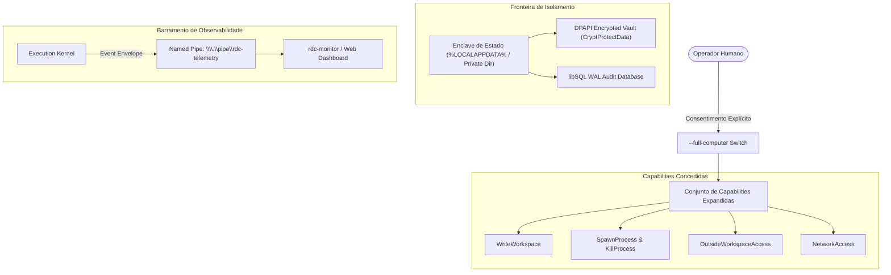

# RFC-0003 — Controle Total do Computador, Isolamento por Enclave e Telemetria em Tempo Real

**Status:** Aprovado & Implementado  
**Versão Alvo:** v0.4.0  
**Data:** 2026-10-09  
**Autor:** Remote Desktop Controller Core Team  
**Repositório:** https://github.com/Remote-Desktop-Controller/remotecontroller  

---

## 1. Sumário Executivo

Historicamente, ferramentas de automação e assistentes baseados em LLM operavam em um dilema extremo: ou confinavam-se a um diretório de workspace estrito (restringindo drasticamente a capacidade de executar comandos de sistema, instalar dependências e inspecionar serviços), ou concediam um shell descontrolado (`sh -c` / `cmd /c` arbitrário), introduzindo graves riscos de segurança e vulnerabilidades catastróficas.

O RFC-0003 estabelece a arquitetura de **Controle Total do Computador com Consentimento Explícito (`--full-computer`)**, isolamento rigoroso via **Enclave de Estado Fora do Workspace**, armazenamento criptográfico de segredos via **Windows DPAPI Vault**, e um barramento dedicado de **Observabilidade e Telemetria em Tempo Real**.

---

## 2. Princípios de Segurança do Modo Full Computer

### 2.1 Rejeição de Shells Genéricos
Mesmo sob `--full-computer`, o runtime **rejeita a invocação cega de shells desestruturados** (`cmd.exe /c "string"`, `powershell -Command "string"` ou `/bin/sh -c`). Cada processo precisa ser invocado com programa binário exato, lista finita e estruturada de argumentos, diretório de trabalho explícito e mapa de variáveis de ambiente sanitizado. Isso mitiga injeções clássicas de linha de comando.

---

## 3. Arquitetura do Enclave de Estado e DPAPI Vault

O daemon de execução e o agente necessitam de persistência sensível (chaves privadas, tokens de sessão, credenciais do banco e histórico de comandos).

### 3.1 Layout do Diretório de Estado
O estado do runtime **jamais** reside dentro do workspace manipulado pelo operador ou agente. O daemon resolve deterministicamente o caminho seguro:
- **Windows:** `%LOCALAPPDATA%\LocalRuntime\<workspace-hash>\`
- **Linux:** `$XDG_DATA_HOME/local-runtime/<workspace-hash>/` ou `~/.local/share/...`
- **macOS:** `~/Library/Application Support/LocalRuntime/<workspace-hash>/`

### 3.2 Cofre Criptográfico DPAPI (`storage::vault`)
No Windows, os segredos gravados em disco são cifrados em repouso através das funções de sistema `CryptProtectData` e `CryptUnprotectData` (módulo `windows::Win32_Security_Cryptography`).
- O texto plano só existe temporariamente na memória RAM do processo.
- Nenhum outro usuário ou processo rodando sob credenciais diferentes pode descriptografar os arquivos de estado, mesmo tendo acesso físico aos blocos do disco.

---

## 4. Edições Atômicas e Diff por Algoritmo de Myers

Operações de escrita e patch de arquivos no filesystem empregam verificação prévia de integridade e o algoritmo de diferenças de Myers (`similar` crate):
1. **Verificação de Hash SHA-256:** Antes de qualquer alteração, o hash do arquivo lido é confrontado com o estado atual no disco. Se houver divergência (modificação externa concorrente), a operação falha imediatamente com `PreconditionFailed`.
2. **Atomicidade via Tempfiles:** As alterações são escritas em arquivos temporários isolados no mesmo volume de disco e ativadas via renomeação atômica (`atomic_write`), prevenindo estados intermediários corrompidos se houver queda de energia ou interrupção de processo.

---

## 5. Telemetria e Observer em Tempo Real (`rdc-telemetry`)

Para garantir transparência operacional contínua, o kernel expõe um canal de broadcast assíncrono via Named Pipe protegido:
- **Endpoint Padrão:** `\\.\pipe\rdc-telemetry` (Windows) ou socket Unix equivalente.
- **Formato:** Fluxo de `ObserverEvent` serializados via JSON / MessagePack.
- **Categorias de Eventos:**
  - `ProcessSpawned`: PID, executável, argumentos, tempo de início.
  - `ProcessTerminated`: PID, código de saída, duração de CPU.
  - `FileTouched`: Caminho, bytes alterados, hash antes/depois.
  - `PolicyBlocked`: Tentativa de acesso bloqueada por falta de capability.

O utilitário CLI `rdc-monitor` consome esse canal em tempo real para exibir na tela do operador tudo o que o agente executa em tempo real.
