# RFC-0006 — RDC Maestro: Loop Autônomo de Debate Colaborativo, Patches Cirúrgicos, Portão de Compliance e Reversão em 1-Clique

**Status:** Aprovado & Implementado  
**Versão Alvo:** v0.5.0  
**Data:** 2026-10-14  
**Autor:** Remote Desktop Controller Core Team  
**Repositório:** https://github.com/Remote-Desktop-Controller/remotecontroller  

---

## 1. Sumário Executivo

A integração ingênua de múltiplos Modelos de Linguagem (LLMs) em ferramentas de desenvolvimento frequentemente sucumbe a quatro patologias críticas:
1. **Execução Cega e Alucinação de Código:** As IAs respondem em um único turno sem acesso prévio aos arquivos do disco local do operador, gerando código hipotético ou desculpas de inacessibilidade ("não tenho acesso aos arquivos no seu computador").
2. **Ausência de Debate e Pensamento Crítico:** Modelos isolados emitem conclusões precipitadas sem debater abordagens, sem especialização de papéis (ex.: algoritmo, segurança, arquitetura) e sem esperar o tempo necessário de *deep thinking* (OpenAI o1/o3, DeepSeek R1, Claude Extended Thinking).
3. **Fragilidade de Edição por Reescrever Arquivos Inteiros:** Forçar LLMs a reescrever arquivos inteiros de milhares de linhas codificados dentro de strings JSON causa estouro de tokens, truncamento de código, erros de escape (`\n`, `\"`) e corrupção silenciosa de bases de código.
4. **Vulnerabilidade Operacional e Degradação de Desempenho:** Aplicações de interface WebView sofrem degradação severa por acúmulo de nós no DOM (> 100 KB de texto) e os operadores hesitam em executar automações por medo de alterações destrutivas sem histórico nem reversão imediata.

O **RFC-0006** resolve essas limitações estruturais no **RDC Maestro v0.5.0**, implementando:
- **Loop Autônomo de Debate Multi-Round (ReAct Loop):** Protocolo estruturado de 3 rodadas (Brainstorming/Divisão de Papéis, Debate Cruzado, Síntese Unificada) com pré-voo automático de arquivos e índice do workspace, auto-read transparente de até 3 turnos e timeouts ampliados de raciocínio profundo (900s).
- **Motor de Patches Cirúrgicos (`SEARCH / REPLACE`):** Extrator de blocos diff contextuais que valida a existência exata do trecho anterior antes de qualquer escrita, impedindo corrupção e eliminando o desperdício de tokens.
- **Portão Obrigatório de Compliance (`Context Log Gate`) e Rollback em 1-Clique:** Registro explícito de intenção, arquivos inspecionados, nível de risco e plano de verificação anexado a cada missão, com botão nativo de reversão física ao byte anterior.
- **Proteção Contra Inchaço de DOM (`Compact & Resume`) e Estado Durável:** Monitoramento contínuo de métricas de DOM com reset limpo das WebViews e persistência local atômica em disco das últimas 50 missões.
- **Estabilização de Preload Universal Multi-Provedor:** Proteção anti-eco no scraping (eliminando a captura acidental do próprio prompt), suporte a nós de assistente do ChatGPT e seletores modernos do Gemini.

---

## 2. Arquitetura Geral do Sistema

```mermaid
sequenceDiagram
    autonumber
    actor Operador as Operador Humano
    participant Maestro as RDC Maestro (Tauri v2)
    participant Preload as Preload Bridge (WebView2)
    participant LLMs as Provedores (Claude / ChatGPT / Gemini / DeepSeek / Qwen)
    participant Daemon as Local Daemon (Rust Kernel)
    participant Disk as Disco do Workspace & CheckpointStore

    Operador->>Maestro: Dispara missão com prompt e referências a arquivos
    Maestro->>Daemon: Pré-Voo: filesystem.list + leitura de arquivos mencionados
    Daemon->>Disk: Lê caminhos mencionados em milissegundos
    Disk-->>Daemon: Conteúdo dos arquivos reais
    Daemon-->>Maestro: Injeção de Workspace Index & Arquivos
    
    rect rgb(20, 24, 38)
        note right of Maestro: Rodada 1: Brainstorming & Atribuição de Papéis
        Maestro->>Preload: Injeta prompt enriquecido com instruções de protocolo
        Preload->>LLMs: Digita com biomecânica estocástica
        LLMs-->>Preload: Respostas iniciais (Raciocínio & Papéis)
        Preload-->>Maestro: Captura e Quórum (idleSettled + anti-echo)
    end

    rect rgb(24, 28, 45)
        note right of Maestro: Rodada 2: Debate Cruzado & Refinamento Crítico
        Maestro->>Preload: Re-injeta propostas cruzadas para refutação mútua
        Preload->>LLMs: Submete para revisão dos pares
        LLMs-->>Preload: Consenso técnico refinado
        Preload-->>Maestro: Captura da Rodada 2
    end

    rect rgb(28, 32, 50)
        note right of Maestro: Rodada 3: Síntese Unificada & Geração de Plano
        Maestro->>Preload: Solicita context_log estruturado e SEARCH/REPLACE
        Preload->>LLMs: Solicita emissão do contrato final
        LLMs-->>Preload: Context Log + Patches Cirúrgicos
        Preload-->>Maestro: Consolidação no Blackboard
    end

    alt Plano contém apenas ferramentas ReadOnly (Auto-Read)
        Maestro->>Daemon: Executa inspeção automática (filesystem.read/search/git)
        Daemon-->>Maestro: Devolve output_preview (alimenta novo turno sem travar)
    else Plano contém mutação física (filesystem.write / SEARCH/REPLACE)
        Maestro->>Operador: Exibe Card de Compliance + Botão [APROVAR E APLICAR NO PC]
        Operador->>Maestro: Clique de Aprovação
        Maestro->>Daemon: Despacha rdc.maestro.order.v1 com context_log
        Daemon->>Disk: Valida blocos SEARCH e grava Checkpoint atômico
        Daemon-->>Maestro: Recibo Ack com checkpoint_id
        Maestro->>Operador: Notifica sucesso e exibe botão [ROLLBACK CHECKPOINT]
    end

    opt Operador solicita reversão física
        Operador->>Maestro: Clique em [DESFAZER / ROLLBACK]
        Maestro->>Daemon: Ordem rollback_checkpoint com checkpoint_id
        Daemon->>Disk: CheckpointStore::restore_checkpoint
        Disk-->>Daemon: Arquivos restaurados ao byte exato
        Daemon-->>Maestro: Ack com restored_files
        Maestro->>Operador: Alerta de reversão concluída com sucesso
    end
```



---

## 3. Especificação do Loop de Debate Multi-Round (ReAct Loop)

### 3.1 Pré-Voo com Extração de Arquivos Mencionados
Para extinguir de forma definitiva a resposta em que modelos afirmam não conseguir ler caminhos como `C:\Users\...\arquivo.ext`, o orquestrador executa o pré-voo `preflight_read_mentioned_files`:
1. **Expressão Regular Regex:** Escaneia o prompt em busca de caminhos Windows/Unix absolutos e relativos (`[A-Za-z]:\\[^"'\n]+` ou `./[^"'\n]+`).
2. **Leitura Local Imediata:** Consulta o pipe `\\.\pipe\rdc-agent-maestro` com `filesystem.read` ou realiza leitura direta do disco em milissegundos.
3. **Injeção de Pré-Voo:** O cabeçalho dos arquivos inspecionados é anexado ao prompt da primeira rodada:
   ```markdown
   [ARQUIVOS MENCIONADOS EXTRAÍDOS AUTOMATICAMENTE PELO MAESTRO LOCAL]:
   --- INÍCIO DE ARQUIVO: C:\caminho\arquivo.ext ---
   <conteúdo real do arquivo>
   --- FIM DE ARQUIVO ---
   ```

### 3.2 Protocolo de 3 Rodadas Colaborativas
O debate entre os provedores de IA conectados segue regras rígidas injetadas em cada turno:
- **Rodada 1 (Brainstorming & Divisão de Funções):** As IAs definem seus papéis complementares (ex.: um agente foca em mecânicas e performance, outro em segurança e arquitetura, outro em estilo e usabilidade). Nenhuma tenta fechar a solução sozinha.
- **Rodada 2 (Debate Cruzado & Implementação Especializada):** As propostas da Rodada 1 são cruzadas entre as WebViews. Agentes apontam inconsistências, gargalos e refinam os trechos de código de acordo com seus papéis designados.
- **Rodada 3 (Síntese Unificada & Portão de Compliance):** O conselho unifica o resultado final, gerando obrigatoriamente o bloco `context_log` e o plano de modificação em blocos cirúrgicos `SEARCH / REPLACE`.

### 3.3 Auto-Read Loop Transparente (`MAX_AUTO_READ_TURNS = 3`)
- Ferramentas classificadas como `ReadOnly` (`filesystem.read`, `filesystem.read_range`, `filesystem.list`, `filesystem.search`, `filesystem.stat`, `git.status`, `git.diff`, `git.show`, `context.overview`, `code.inspect`, `code.symbols`) são executadas pelo daemon imediatamente.
- O Maestro emite o evento `maestro-auto-read-started`, captura os resultados retornados no campo `output_preview` e re-alimenta as WebViews automaticamente sem exigir intervenção humana, avançando o turno até que o plano de escrita esteja completo ou o limite de 3 turnos de leitura seja atingido.

### 3.4 Janelas de Timeout de Raciocínio Profundo
Para garantir suporte total a modelos contemporâneos de alta capacidade que realizam cadeias estendidas de raciocínio antes de emitirem os primeiros caracteres visíveis:
- **`DEBATE_TIMEOUT`:** Ampliado para **900 segundos (15 minutos)**.
- **`POST_QUORUM_GRACE`:** Janela de tolerância estendida para **300 segundos (5 minutos)** após o primeiro quórum, permitindo que modelos mais lentos e analíticos concluam suas reflexões sem serem descartados prematuramente.

---

## 4. Motor de Patches Cirúrgicos (`SEARCH / REPLACE`)

### 4.1 A Falha dos Modelos Tradicionais de Reescrita Integral
Submeter arquivos inteiros em JSON impõe as seguintes falhas estruturais:
- Custo astronômico de contexto: um arquivo de 1.000 linhas requer 1.000 linhas no prompt de resposta para alterar 3 linhas de lógica.
- Falhas de sintaxe e corrupção: aspas não escapadas ou quebras de linha em strings JSON provocam erro de parse no deserializador.
- Risco de truncamento: limites de saída de modelos de chat frequentemente interrompem arquivos no meio, deixando o código quebrado.

### 4.2 Formato Cirúrgico do Maestro
O extrator do `local-daemon` e do Maestro processa nativamente blocos delimitados no formato de substituição textual contextual:

```text
<<<<<<< SEARCH: src/game/engine.js
function updatePhysics() {
    velocity += acceleration;
}
=======
function updatePhysics() {
    velocity += acceleration * deltaTime;
    clampVelocity();
}
>>>>>>> REPLACE
```

### 4.3 Garantias Determinísticas e Prevenção de Corrupção
1. **Verificação de Unicidade:** O motor busca a ocorrência literal do bloco `SEARCH` no arquivo alvo lido do disco.
2. **Falha Atômica:** Se o bloco `SEARCH` não for localizado ou for vazio, a operação falha imediatamente com o erro estruturado `SearchBlockNotFound: trecho SEARCH não encontrado no arquivo alvo`. Nenhuma modificação é gravada no disco.
3. **Pipeline de Segurança:** A mutação final é despachada através de `Kernel::dispatch` com a ferramenta `filesystem.write` ou `filesystem.patch`, acionando a criação atômica de checkpoint no `CheckpointStore` e preservando a árvore de auditoria.

---

## 5. Portão de Compliance e Reversão em 1-Clique

### 5.1 Especificação do Esquema `context_log`
Nenhuma ordem com ferramentas mutantes é despachada sem que os metadados de conformidade sejam consolidados no envelope `rdc.maestro.order.v1`:

```json
{
  "protocol": "rdc.maestro.order.v1",
  "order_id": "ord-1792015000-001",
  "mission_id": "m-1792015000-000",
  "kind": "execute_plan",
  "context_log": {
    "intent": "Otimizar o loop de renderização do canvas e desacoplar física em deltaTime fixo",
    "files_inspected": [
      "C:\\Users\\Notebook\\Downloads\\gemini-code-1791979928420.html"
    ],
    "risk_level": "medium",
    "verification_plan": "Testar inicialização do canvas em 60 FPS com monitor de alocação de partículas"
  },
  "steps": [...]
}
```

### 5.2 Protocolo de Rollback em 1-Clique
1. **Persistência de Checkpoints:** Ao executar mutações físicas, o `Kernel` registra cada arquivo modificado no `CheckpointStore` antes de aplicar os bytes novos, associando a operação a um `checkpoint_id` (UUID v4).
2. **Exibição na Interface:** Ao receber a confirmação de execução bem-sucedida (`status: "completed"`), a interface do Maestro exibe o botão estilizado **[DESFAZER NO PC (ROLLBACK CHECKPOINT)]**.
3. **Despacho da Ordem de Reversão:** O clique aciona o comando Tauri `maestro_rollback_checkpoint(checkpoint_id)`, que envia ao pipe:
   ```json
   {
     "protocol": "rdc.maestro.order.v1",
     "order_id": "ord-rollback-001",
     "mission_id": "m-rollback-000",
     "kind": "rollback_checkpoint",
     "checkpoint_id": "a5e8f412-87c2-4a55-b4de-5f9cb2573210"
   }
   ```
4. **Ack de Restauração:** O daemon recupera os snapshots originais e restaura os arquivos byte a byte, retornando no recibo `rdc.maestro.ack.v1` a lista de `restored_files`.

---

## 6. Proteção de DOM (`Compact & Resume`) e Estado Durável Local

### 6.1 Módulo `state_store.rs`
O backend do Maestro persiste o ciclo de vida completo das missões de forma atômica no diretório de dados do usuário:
- **Caminho:** `%USERPROFILE%\.remotecontroller\maestro-missions.json`
- **Capacidade:** Histórico circular das últimas 50 missões com chaveamento por `mission_id`.
- **Campos:** `mission_id`, `prompt`, `turns`, `context_log`, `consensus_summary`, `last_checkpoint_id`, `execution_ack`, `created_at_epoch_ms`.
- **Persistência Atômica:** Gravação via arquivo temporário com substituição atômica (`rename`), evitando corrupção de estado em desligamentos abruptos.

### 6.2 Telemetria de Inchaço de DOM e Alerta de 100 KB
As WebViews acumulam mensagens contínuas, provocando lentidão no mecanismo de renderização do Chromium/WebView2:
- **Métricas:** O método `MaestroBridge.getDomMetrics()` afere continuamente `turnCount` e `domChars`.
- **Gatilho de Alerta:** Quando `domChars > 100.000` (100 KB), a interface destaca um alerta de recomendação de compactação.

### 6.3 Operação `Compact & Resume`
Ao acionar o botão **[Compactar & Novo Chat]** no topo da IDE:
1. O resumo consensual e o `context_log` da sessão atual são compactados e persistidos no `state_store`.
2. O comando comanda as instâncias de WebView a navegarem para suas URLs limpas de novo chat (`https://chatgpt.com/`, `https://claude.ai/new`, `https://gemini.google.com/app`).
3. O `compacted_header` resultante é retido em memória para ser automaticamente injetado como preâmbulo contextual da próxima missão submetida pelo operador.

---

## 7. Estabilização Universal do `preload.js` Multi-Provedor

| Provedor | Sintoma Anterior | Solução Implementada no Preload |
|---|---|---|
| **ChatGPT** | Captura travada em `stoppedAtUserTurn` devido a mudanças na hierarquia de elementos do DOM | Inspeção direta de seletores `[data-message-author-role="assistant"]` e `.agent-turn`, com verificação prioritária de nós filhos de resposta |
| **Qwen** | Captura precipitada do próprio prompt do usuário antes da resposta do assistente ser gerada | **Anti-Echo Guard:** verificação `compactText(text) === compactText(this.lastPromptText)`. Se o texto for idêntico ao prompt, o scraper descarta o snapshot e aguarda a geração do modelo |
| **Gemini** | Falha de detecção de término de streaming em versões atualizadas da interface | Inclusão de seletores modernos (`message-content`, `model-response`, botões com `aria-label*="Interromper"` / `Stop response`) e monitor de estabilização `idleSettled` |
| **Claude** | Perda de formatação e foco em caixas de entrada baseadas em ProseMirror | Injeção estruturada em nós `.ProseMirror` com emissão de eventos nativos de `input` e simulação estocástica de envio via Enter |
| **DeepSeek** | Transição de raciocínio interno (*thinking tags*) para bloco final de código | Scraping do contêiner integral de resposta, preservando o raciocínio e isolando blocos ```html / ```javascript / ```json |

---

## 8. Conformidade, Regras de Build e Não-Regressão

1. **Toolchain GNU/MinGW no Windows:** O arquivo `apps/rdc-maestro/src-tauri/Cargo.toml` mantém estritamente `crate-type = ["rlib"]`. A tentativa de inclusão de `cdylib` ou `staticlib` rompe a linkagem do binário Tauri devido a conflitos de tabela de símbolos ordinais no GNU ld (`export ordinal too large` ou falha de merge no `.rsrc`).
2. **Despacho Estrito via Kernel:** Toda e qualquer execução de arquivo ou comando no computador físico ocorre obrigatoriamente através de `Kernel::dispatch` no `local-daemon`, assegurando a aplicação de políticas de sandbox (`--allow-write`), barreiras de diretório e registro imutável em libSQL.
3. **Retrocompatibilidade de Protocolo:** Todos os formatos introduzidos (`output_preview`, `context_log`, `rollback_checkpoint`, `SEARCH / REPLACE`) são extensões aditivas retrocompatíveis sobre o contrato `rdc.maestro.order.v1` e `rdc.maestro.ack.v1`.

---

## 9. Métricas de Validação e Homologação

Os 5 estágios foram implementados e homologados com os seguintes resultados de compilação e teste:

| Subsistema / Teste | Comando de Execução | Resultado |
|---|---|---|
| **Sintaxe do Preload Bridge** | `node --check apps/rdc-maestro/src-tauri/src/preload.js` | **EXIT 0** (Sintaxe válida, 0 erros) |
| **Testes do Local Daemon** | `cargo test -p local-daemon` | **EXIT 0** (34 testes aprovados: 26 unitários + 8 integração) |
| **Testes do Maestro Backend** | `cargo test -p rdc-maestro --lib` | **EXIT 0** (22 testes unitários aprovados) |
| **Bundle Frontend React/TS** | `npm run build` em `apps/rdc-maestro` | **EXIT 0** (Vite build limpo sem erros de tipagem) |
| **Linkagem do Executável** | `cargo build -p rdc-maestro` | **EXIT 0** (Binário `rdc-maestro.exe` linkado com sucesso) |
