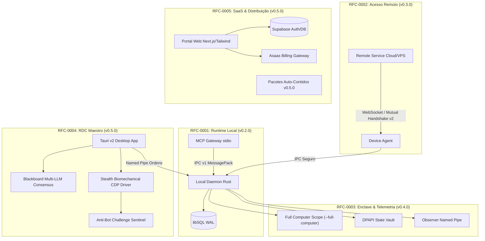

# Remote Desktop Controller (RDC) — RFC Index

Este diretório contém os **Request for Comments (RFCs)** do projeto Remote Desktop Controller (RDC).
Cada RFC documenta decisões arquiteturais fundamentais, especificações de protocolos, limites de segurança e evolução dos contratos entre componentes.

---

## Índice de RFCs

| RFC | Título | Status | Versão Alvo | Data |
|---|---|---|---|---|
| [RFC-0001](0001-runtime-local.md) | **Runtime Local de Execução para Agentes** | Aprovado & Implementado | v0.2.0 | 2026-09-30 |
| [RFC-0002](0002-remote-pairing-protocol.md) | **Protocolo de Pareamento Remoto e Handshake Mútuo v2** | Aprovado & Implementado | v0.3.0 | 2026-10-05 |
| [RFC-0003](0003-full-computer-access-enclave.md) | **Controle Total do Computador, Isolamento por Enclave e Telemetria em Tempo Real** | Aprovado & Implementado | v0.4.0 | 2026-10-09 |
| [RFC-0004](0004-rdc-maestro-stealth-orchestrator.md) | **RDC Maestro — Orquestrador Multi-Provedor Desktop e Motor Furtivo de Execução** | Aprovado & Implementado | v0.5.0 | 2026-10-13 |
| [RFC-0005](0005-commercial-portal-distribution.md) | **Portal Comercial SaaS, Faturamento Integrado e Distribuição Tri-Plataforma v0.5.0** | Aprovado & Implementado | v0.5.0 | 2026-10-13 |

---

## Mapa Evolutivo da Arquitetura

---

## Ciclo de Vida e Regras de Governança

1. **Local-First por Padrão:** Nenhuma funcionalidade deve exigir conexão com a internet para executar operações locais de computação e runtime.
2. **Segurança de Menor Privilégio:** Permissões de escrita, execução de processos fora do workspace e acesso de rede devem ser deliberadamente concedidas pelo operador.
3. **Imutabilidade e Durabilidade:** Todas as operações que alteram estado passam pelo motor de transação libSQL em modo WAL com integridade referencial.
4. **Sem Regressões:** Qualquer novo RFC deve manter retrocompatibilidade com o protocolo IPC v1 ou definir transição explícita com negociação de versão.
