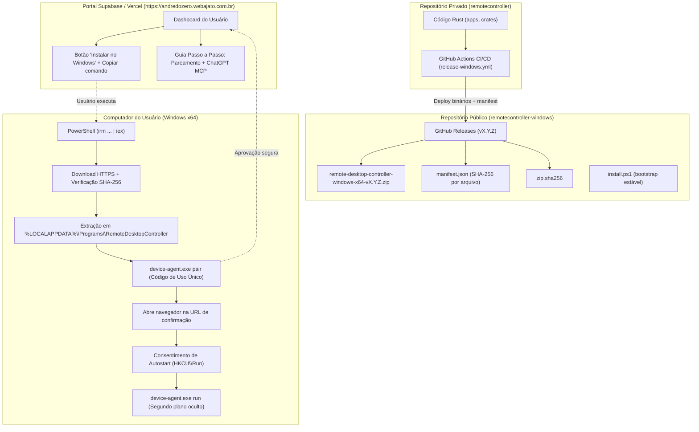

# Design: Distribuição Pública e Instalação Guiada do Remote Controller Windows

Data: 2026-10-09  
Branch de desenvolvimento: `feat/commercial-portal`  
Repositório de distribuição pública: `Remote-Desktop-Controller/remotecontroller-windows`  
Servidor oficial: `https://andredozero.webajato.com.br`  

---

## 1. Visão Geral e Arquitetura

O objetivo é permitir que qualquer usuário leigo instale o **Remote Controller** no Windows x64 com um único comando PowerShell copiado do portal, realize o pareamento guiado via navegador e conecte o agente ao ChatGPT como ferramenta MCP, sem exigir compilação Rust, Cargo, Git ou manipulação manual de arquivos ZIP.



---

## 2. Componentes

### 2.1. Pipeline GitHub Actions (`.github/workflows/release-windows.yml`)
- Executa em `windows-latest`.
- Compila em `--release`: `device-agent.exe` e `local-daemon.exe`.
- Utiliza `tools/package-product.ps1` para gerar:
  - Pacote `remote-desktop-controller-windows-x64-<version>.zip`.
  - `manifest.json` com SHA-256 de cada executável e arquivo de licença/instalação.
  - Arquivo `*.zip.sha256`.
- Prepara publicação para o repositório público `Remote-Desktop-Controller/remotecontroller-windows`:
  - Publicação condicionada a tag ou despacho manual (`workflow_dispatch`).
  - O código-fonte privado nunca é incluído no release; apenas binários compilados, hashes e licenças.

### 2.2. Script de Instalação e Bootstrap (`install.ps1`)
- **Ponto de entrada:**
  ```powershell
  irm https://raw.githubusercontent.com/Remote-Desktop-Controller/remotecontroller-windows/main/install.ps1 | iex
  ```
- **Fluxo de execução:**
  1. **Validação de ambiente:** Windows 10/11 x64, PowerShell 5.1+.
  2. **Consulta de versão estável:** Consulta a API de releases do GitHub para resolver a última versão estável lançada (ex: `v0.3.0`), ou aceita `-Version` explicitamente.
  3. **Download e Verificação Criptográfica:**
     - Baixa `manifest.json` e `remote-desktop-controller-windows-x64-<version>.zip` para `%TEMP%\rdc-install-...`.
     - Calcula o SHA-256 do arquivo zip baixado e compara estritamente com o manifesto oficial. Interrompe a execução caso haja divergência.
  4. **Instalação em Staging Seguro:**
     - Cria pasta de destino em `%LOCALAPPDATA%\Programs\RemoteDesktopController\<version>`.
     - Extrai o conteúdo e valida individualmente o SHA-256 de `device-agent.exe` e `local-daemon.exe`.
     - Cria script `uninstall.ps1` no diretório raiz do programa.
  5. **Configuração Amigável e Segura:**
     - Se o computador já foi pareado (`agent.json` existe), preserva credenciais e configurações existentes.
     - Caso seja primeira instalação:
       - Pergunta o nome do computador (padrão: `$env:COMPUTERNAME`).
       - Exibe janela de seleção de pasta (ou prompt) para escolher o Workspace autorizado (padrão: `$HOME\RemoteWorkspace`).
       - Segurança restritiva por padrão: leitura autorizada, escrita/processo/terminal **desabilitados** salvo consentimento explícito.
       - Configura servidor oficial: `https://andredozero.webajato.com.br`.
  6. **Pareamento Guiado:**
     - Executa `device-agent.exe pair`.
     - Captura o código de uso único (ex: `ABCD-1234`) e a URL de aprovação.
     - Abre o navegador padrão na página de aprovação e exibe instruções visuais destacadas no terminal.
     - Aguarda confirmação do usuário no portal.
  7. **Consentimento de Inicialização Automática:**
     - Pergunta de forma clara: *"Deseja que o Remote Controller inicie automaticamente ao ligar o computador? [S/N]"*.
     - Se aprovado, registra em `HKCU\Software\Microsoft\Windows\CurrentVersion\Run`.
  8. **Inicialização em Segundo Plano:**
     - Inicia `device-agent.exe run` com `-WindowStyle Hidden`.
     - Verifica se o processo está em execução via heartbeat do daemon.
     - Mensagem de sucesso: o usuário pode fechar o PowerShell imediatamente.

### 2.3. Rotinas de Desinstalação e Atualização
- **Desinstalação (`uninstall.ps1`):**
  - Para processos ativos (`device-agent stop` e encerra eventuais daemons orfãos).
  - Remove chave de autostart do registro do usuário (`HKCU\...\Run`).
  - Pergunta se o usuário deseja remover as credenciais e histórico locais (`%LOCALAPPDATA%\RemoteDesktopController`).
  - Remove os binários instalados em `%LOCALAPPDATA%\Programs\RemoteDesktopController`.
- **Atualização (`install.ps1 -Update`):**
  - Detecta versão instalada, baixa a nova versão estável, valida SHA-256 em staging, para o agente anterior com segurança, atualiza os binários e reinicia o agente preservando o perfil pareado.

### 2.4. Experiência no Portal Comercial (`apps/portal`)
- **Dashboard (`/dashboard`):**
  - Seção proeminente: **"Instalar no Windows"**.
  - Caixa de comando estilizada com botão de 1 clique para copiar o PowerShell oficial.
  - Indicadores de etapas:
    1. Copie e cole no PowerShell.
    2. Autorize o código gerado no navegador.
    3. Conecte ao seu ChatGPT.
- **Instruções e Guia de Conexão MCP ao ChatGPT:**
  - Passo a passo visual acessível a qualquer usuário leigo:
    - URL do servidor MCP: `https://andredozero.webajato.com.br/mcp`
    - Tipo de autenticação: OAuth / Conta conectada.
    - Como adicionar no ChatGPT: Menu de Configurações -> Aplicativos Conectados (MCP) -> Adicionar Servidor MCP.

---

## 3. Segurança e Restrições Operacionais

1. **Sem Elevação de Privilégios (No UAC / No Admin):**
   - A instalação ocorre 100% no espaço do usuário (`%LOCALAPPDATA%`), evitando solicitações de UAC desnecessárias.
2. **Sem Contorno de Segurança:**
   - Nunca instruir o usuário a desativar Windows Defender, antivírus ou SmartScreen.
   - Todo arquivo é verificado criptograficamente por SHA-256 antes da execução.
3. **Mínimo Privilégio Operacional:**
   - Permissões de escrita de arquivos (`allow_write`), processos unconfined (`allow_process`) e terminal iterativo (`allow_terminal`) permanecem desligadas por padrão.
4. **Isolamento de Contas e Planos:**
   - Clientes Premium e limites diários Free mantêm suas regras intactas.
   - Sem migrations na VPS nesta etapa; nenhum reinício de serviços em produção sem autorização final.
